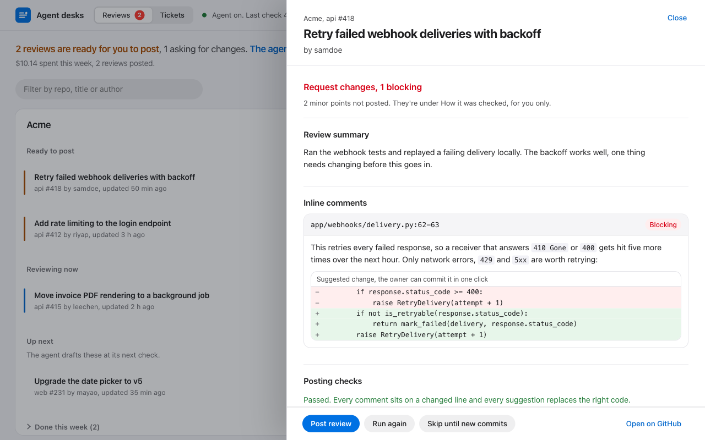
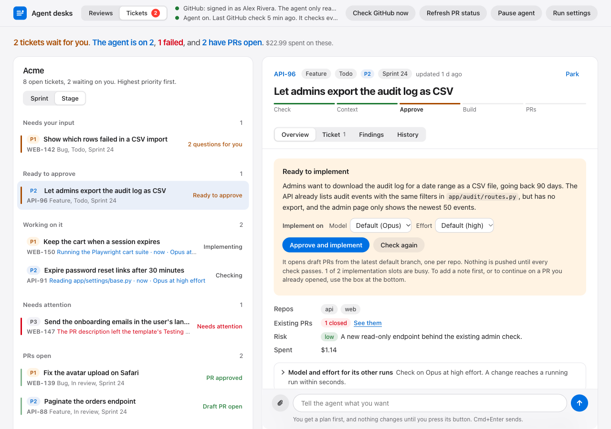

# Legwork

[](https://github.com/abdelazizElemary/legwork/actions/workflows/kit-checks.yml)
[](LICENSE)


**Legwork keeps track of your daily assigned tasks and the PRs waiting for your review, and does the legwork on
them with [Claude Code](https://code.claude.com).**

It runs two agents in the background on your own machine, each with a desk in your browser. They do the
building, testing, checking and drafting. You make the calls, and nothing goes out until you approve it.

- **Review desk (`prr`).** When someone asks for your review, it builds and tests the PR in its own worktree,
  measures the test coverage of the changed lines, checks the change against the repo's own patterns, and drafts
  a review in your voice. Every finding is proven from the code with a `path:line`. Needed changes become GitHub
  suggestion blocks; minor points stay private on the desk. You read it and press Post, or skip it.
- **Ticket desk (`ptk`).** It lists the tickets assigned to you (GitHub Issues, a GitHub Projects board or Jira),
  grouped by sprint and sorted by priority. It checks whether each one has enough context and asks you on the desk
  when it doesn't. After you approve one, it implements it on a new branch from the latest default branch and
  opens one draft PR per repo. Then it follows those PRs (CI, reviews, comments), and when there's feedback you
  tell it what to change and it adds commits to the same PR.





Both desks let you pick the model and effort for each run, and a change reaches a running agent within seconds.
Several tickets can run at once. When a run fails, the desk explains what happened and why, and **Fix it** resumes
the same session with the fix.

## You stay in charge

- **Nothing is posted or pushed without you.** Reviews wait on the desk until you press Post. Ticket work starts
  only after you approve the ticket, PRs open as drafts, and the push happens only after the agent's own checks
  pass. Reworks only add commits; nothing is ever force-pushed.
- **Your checkouts are never touched.** All work happens in worktrees under `<workspace>/.local/wt/`. Guards in
  front of git and gh block pushes, posts, checkouts and GitHub writes from the Claude runs.
- **Your tracker stays read-only.**
- **It's your identity.** Commits, PRs and reviews carry your name. By default nothing mentions AI. If your team or
  the projects you work on ask for disclosure, set `attribution.mode` to `"disclose"` and the kit adds a
  `Co-Authored-By: Claude` trailer and a footer itself.
- **The desks are local.** They listen on 127.0.0.1 only, with a token in the URL.
- **Every run has a cap.** Each Claude run has a dollar limit and a timeout from your config, and the desks show
  what each run cost.

## What you need

- macOS or Linux, and Python 3.9 or newer (the agents use the standard library only)
- [Claude Code](https://code.claude.com), signed in
- [`gh`](https://cli.github.com) signed in to your GitHub host (`gh auth login`), git with SSH access, and `jq`
- whatever your repos need to build and test (node, uv, poetry and so on)

## Quick start

```bash
git clone https://github.com/abdelazizElemary/legwork.git
cd legwork
claude
```

Then say: **Follow PROMPT.md**. Claude sets it up with you:

1. It finds your git identity, GitHub login, repo checkouts, default branches and PR conventions.
2. It learns how you write from your own review comments, PR descriptions and commits, and how you review
   (approve silently or with a note, post minor points or keep them private), and shows you the result to correct.
3. It asks what it couldn't find, in one round: which orgs, where your tickets live, your branch and title format,
   budgets and attribution.
4. It shows you the install plan and installs only after you agree.
5. It maps each of your projects (how to build and test it, its house patterns with `path:line`) and runs the
   doctors.
6. It starts the two background jobs when you say go.

It never writes to GitHub or spends money without asking first. Your settings go in `kit.config.json`, your voice
and habits in `profile/`, and your project maps in `references/`. Git ignores all three, so they stay on your
machine. Copy them yourself if you set up another one.

## Day to day

```
prr dashboard                     the Review desk          ptk dashboard                     the Ticket desk
prr list | show <pr> | post <pr> | review <pr> | pause | resume | doctor
ptk list | show <KEY> | check <KEY> | approve <KEY> | context <KEY> "<text>" | doctor
ptk fix <KEY> ["what to change"] [--fresh | --pr-step]     resume a failed run with a fix
ptk rework <KEY> ["what to change"] [--image FILE ...]      more work on the same PRs (or a follow-up PR), with screenshots
ptk prs [<KEY>]                                              read the PRs' state from GitHub now
prr settings --effort high        ptk settings implement --model opus --effort max
```

`prr pause` and `ptk pause` stop all automatic runs; the desks keep refreshing.

## What it costs

Legwork uses your own Claude Code sign-in, so runs count against your plan or API usage. Cost grows with the size
of the PR or ticket and the model and effort you pick: a small review or a ticket check is usually a dollar or two,
and a large PR or an implementation with long test runs costs more. With `ticket.auto_check: "all"` every new
ticket gets checked by itself; with `"none"` a check starts only when you press Check. Setup asks which you want.
Keep the budgets in the config as caps, not targets.

## Configuration

Setup writes `kit.config.json` from [`kit.config.example.json`](kit.config.example.json). Every field is explained
in [`kit.json`](kit.json) under `config_reference`. The ones people change most:

| Setting | What it decides |
|---|---|
| `review.policy` | An approve is `silent` (no body) or carries a `note`; minor points stay `private` or get `post`ed |
| `style` | Switches `post_review.py` enforces on reviews and PR text: no emoji, no headers, word limits and so on |
| `ticket.tracker` | Where your tickets live: GitHub Issues, a GitHub Projects board, or Jira |
| `ticket.conventions` | Your branch, PR title and commit subject formats, checked before anything is pushed |
| `ticket.auto_check` | Check every new ticket automatically (`"all"`) or only when you press Check (`"none"`) |
| `attribution` | `"none"` (the default) keeps tool mentions out; `"disclose"` adds a commit trailer and a footer |

After a change, run `python3 install.py --config kit.config.json --apply --force`.

## Updating

```bash
cd legwork && git pull
python3 install.py --config kit.config.json --apply --force
```

The installer replaces the kit's code and keeps your config, state, drafts and project references. What changed
is in [CHANGELOG.md](CHANGELOG.md).

## How it works

[docs/design.md](docs/design.md) explains how the parts fit together: the scheduler jobs, the guards, the worktrees,
the posting and push checks, and how a ticket moves from assigned to merged. [docs/lessons.md](docs/lessons.md)
lists what broke so far and how the kit handles it.

| Path | What |
|---|---|
| `PROMPT.md` | What to tell Claude to set it up |
| `IMPLEMENT.md` | The step-by-step runbook that prompt points to |
| `kit.json` | Manifest: components, every file and where it installs, config reference, policies |
| `kit.config.example.json` | The settings Claude fills in with you |
| `install.py` | Installer. A dry run by default; it never replaces your config or state |
| `package.py` | Copies your project maps into `references/`, checks for drift, writes an optional zip |
| `rules/CLAUDE.md` | Standing rules, added to `~/.claude/CLAUDE.md` inside markers |
| `skills/pr-review/` | The review skill, a neutral voice template, suggestion mechanics, and how to map a project |
| `skills/ticket-work/` | The ticket skill (assess, implement, rework) |
| `agents/` | Both agents, their desks, the GitHub and Jira trackers, and the shared guards |
| `service/` | launchd and systemd templates |
| `profile/`, `references/` | Yours, not in git: your voice and habits, and your project maps |

## Contributing

Bug reports, ideas and pull requests are welcome. Read [CONTRIBUTING.md](CONTRIBUTING.md) first. The tests install
the kit into a throwaway home with a fake `claude` and `gh`, so they're free and safe to run:

```bash
python3 -m venv .venv && .venv/bin/pip install -r tests/requirements.txt && .venv/bin/python -m pytest tests
```

Please report security problems privately, as [SECURITY.md](SECURITY.md) describes. Everyone taking part follows the
[code of conduct](CODE_OF_CONDUCT.md).

## License

[MIT](LICENSE). Legwork is a community project. It isn't affiliated with or endorsed by Anthropic. Claude and Claude
Code are trademarks of Anthropic, PBC.
